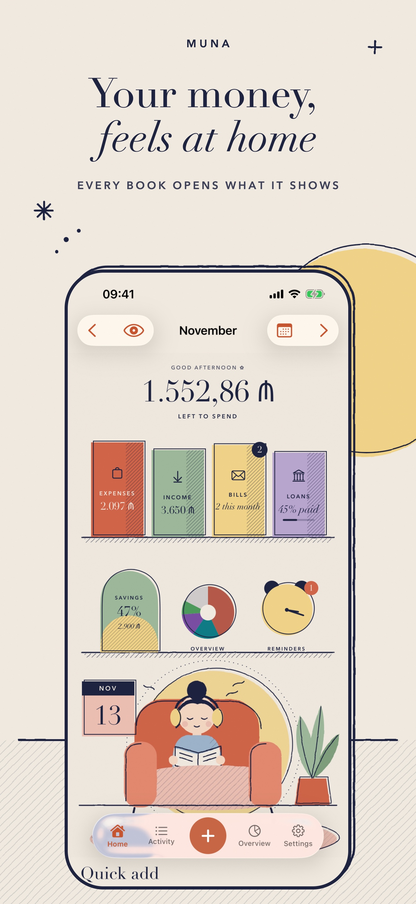
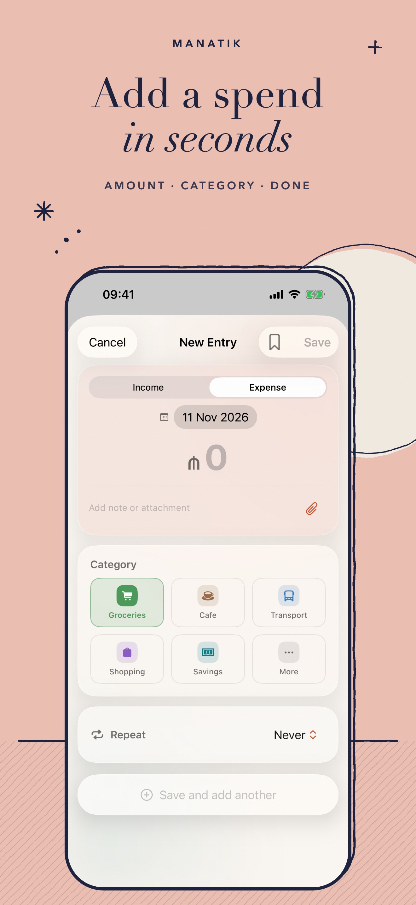

<p align="center">
  
</p>

<h1 align="center">muna</h1>
<p align="center"><em>money feels like home.</em></p>

**Muna — A Softer Way to Save.** Inspired by *Money + Serenity*, muna is a
cozy personal budget app for iPhone. It tracks spending, income, savings
goals, loans and bills, and keeps all of it on your phone.

<p align="center">
  
  
  
  
</p>

## Features

- **Home page styles:** Classic, or an illustrated room (cozy or poster;
  girl, boy or Christmas) where every object is a live button: the books
  open Expenses, Income, Bills and Loans, the jar shows savings, the clock
  opens reminders.
- **Fast entry:** the amount field opens with the number pad, thousands are
  grouped as you type, and categories can be searched.
- **Every currency:** each entry keeps its own currency (159 available);
  totals add up the main currency, with other currencies shown separately.
  Amounts are never converted.
- **Bills:** attach photos or PDFs to any entry and open them with Quick
  Look, including straight from Activity.
- **Savings goals, loans and payment reminders** with local notifications.
- **Overview:** spending by category, income vs expense, daily spending and
  a year view.
- **Hide amounts** with one tap (shown as `---- ₼`).
- **Import and export:** JSON backup and restore, and CSV import from other
  budget apps.
- **Quick add widget** for the Home Screen and Lock Screen.
- **Feedback:** shake the phone to email a report with a screenshot.
- **Languages:** English, Azerbaijani and Russian.
- **Private by design:** no account, no server, no analytics. See
  [PRIVACY.md](PRIVACY.md).

## Requirements

- iPhone with **iOS 17.6** or later. Liquid Glass is used on iOS 26 and
  later; iOS 17 and 18 get the standard material.
- **Xcode 26** or later to build.

## Building

1. Open `muna.xcodeproj` in Xcode.
2. Select the **muna** scheme and an iPhone or simulator.
3. In **Signing & Capabilities**, choose your team for both targets,
   **muna** and **MunaWidget**.
4. Press **Run**.

No packages or setup steps are needed; the project has no third-party
dependencies.

> **Building from a sandboxed shell:** if every `@State` / `@Observable` /
> `#Preview` fails with "external macro implementation type could not be
> found", pass `OTHER_SWIFT_FLAGS='$(inherited) -disable-sandbox'` to
> `xcodebuild`. Builds from Xcode itself are not affected.

## Project layout

| Folder | Contents |
|---|---|
| `App/` | App entry point, splash, deep links (`muna://add`), DEBUG launch options |
| `Core/` | Theme, colours, Liquid Glass wrappers with older-iOS fallbacks |
| `Models/` | Entries, series, goals, loans, reminders, settings |
| `Store/` | `AppStore`, the single observable source of truth |
| `Persistence/` | Versioned JSON storage with migrations and safety copies |
| `Services/` | Attachments, reminders, CSV import, feedback email |
| `ViewModels/`, `Views/`, `Components/` | SwiftUI screens and shared pieces |
| `Utilities/` | Formatting, amount input, date ranges, analytics |
| `Resources/` | Asset catalog, string catalog (en/az/ru), privacy manifest |
| `Widget/` | The Quick add widget extension |
| `Design/` | Source artwork, App Store posters, deck and the scripts that build them |

## Data

Budget data is stored as a single JSON file in the app's Documents folder
(`manatik-state.json`, a name kept from before the rename so existing data
still opens), with attachments under `Documents/Attachments`. Both are
protected while the device is locked. The file format is versioned, and
older formats are migrated on load. If the file cannot be read, the app
refuses to save over it.

## Screenshots and store assets

DEBUG builds accept launch options for repeatable screenshots, for example:

```
xcrun simctl launch <device> com.minayayagubova.manatik -qa-seed -qa-home posterGirl
xcrun simctl launch <device> com.minayayagubova.manatik -qa-seed -qa-route add -qa-amount 24,50
```

`-qa-seed` swaps in demo data held in memory, so the real data file is never
touched. Other options: `-qa-tab`, `-qa-route`, `-qa-hide-amounts`,
`-qa-no-glass` (shows the iOS 17/18 look) and `-qa-open-url`.

To rebuild the App Store posters from a folder of screenshots:

```
python3 Design/make_store_posters.py <screenshots folder> Design/AppStore
```

Store text (subtitle, keywords, What's New) is in
`Design/AppStore/STORE_TEXT.md`.

## Feedback and support

Shake your iPhone in the app, or write to
[minaya.yagubova@icloud.com](mailto:minaya.yagubova@icloud.com).

## License

© 2026 Minaya Yagubova. All rights reserved.

## Voice entry MVP

On New Entry, tap the small microphone next to Save. Choose a
speech language if needed, then tap the round microphone to record. Tap Stop, correct the transcript if necessary, and
choose Review entry. The existing editable form shows the result; only Save
writes it to the ledger. Bills use the existing bookmark flag.

Settings → Language & voice offers an app language (Follow iPhone, English,
Russian or Azerbaijani) and a dedicated Voice settings page. Voice settings
controls dictation language, example visibility, whether + opens voice first,
and whether the recorder starts automatically on opening. All switches except
example visibility default to off. App language changes
apply immediately, including model-generated text. Dictation language lives in Voice settings, accessible from Settings or the
voice screen’s gear button. The Bills bookmark sits beside Income/Expense.

Voice-first entry offers Enter manually to reach the usual amount form.
Review shows the editable form without reopening voice; Cancel closes a
voice-first add. Category shortcuts and editing keep their usual forms.
Automatic recording attempts only once per presentation, after the screen is
active, and still requests the required permissions. Stopping, interruptions,
backgrounding and returning from settings do not restart the microphone.

The searchable language picker lists all locales reported by Apple Speech,
with native language names and a separate section for languages unavailable
offline on the current device. Automatic matches iPhone language preferences
to an offline locale. Speech uses Apple's on-device recognizer exclusively,
with no API key or backend. Availability depends on the selected language and device; a language
in the picker is not a guarantee of offline support. Permission denial or
unavailable recognition leaves typed command entry available. Recording stops
after 45 seconds, on interruption, on backgrounding, or when leaving the sheet.

The rules accept one positive amount with up to two decimal places, numeric
or supported spelled-out numbers (preferring the selected speech locale),
income/expense keywords, visible category
names (including custom categories), and common Russian/English/Azerbaijani
aliases. Currency codes are supported, with common manat/dollar/euro names
and symbols. Unspecified currency uses the form's current currency. Missing
or ambiguous category uses Other. Review all fields before saving.

Dates default to today; today/yesterday/tomorrow and day-before-yesterday
are recognized in English, Russian and Azerbaijani. Other dates, automatic
recurring commands, loan creation,
savings actions, automatic language detection and multiple entries per command
are outside this MVP. Change the date and other fields in the review form.

Run parser regression checks on macOS with Xcode installed:

```sh
python3 Scripts/test_voice_parser.py
python3 Scripts/test_voice_recorder.py
```

Before release, test real microphone recognition on supported iPhones,
permission allow/deny, unavailable languages, cancellation, interruptions,
and review/save/cancel with a test ledger.

Voice recognition uses a dictation hint and up to 100 context phrases from
financial vocabulary and visible category names. Hints bias Apple's recognizer;
they cannot guarantee transcription of mixed-language speech. Stop ends audio
capture and waits for a final transcription before enabling review. A five-second
fallback preserves the partial transcript with an explicit warning if Apple does
not finish. Leaving the screen cancels immediately and invalidates old callbacks.
The recorder regression harness exercises production lifecycle code against
hardware-free Speech/audio stand-ins; real recognition accuracy requires testing
on an iPhone.

Command parsing understands income/доход/входящие/gəlir and
expense/расход/xərc, transportation/транспорт, shopping, bill markers, grouped
amounts and thousands (e.g. «пять тысяч», «5 тысяч», «5 000»). One command must
contain one amount and currency, including when numbers use different languages.
Explicit income stays income even if an expense-only category is spoken; the
review form selects Other and asks the user to choose a compatible category.

### Vocabulary audit

`Services/VoiceVocabulary.swift` is the shared vocabulary for speech hints and
parsing. It covers all 24 built-in categories in English, Russian and Azerbaijani,
plus visible custom category names. Specific names win over overlapping generic
names; numbers in category names (e.g. 7 Eleven) do not become extra amounts.
Freelance, bonus and custom income-only categories infer income unless an
explicit expense command is given. Income/expense and Bills negations are handled.

Currency handling accepts ISO codes, localized currency names from Foundation,
common regional names and currency symbols. Dollar symbols/names follow a dollar
main currency when appropriate; qualified names such as Canadian dollars take
precedence. Ambiguous yen symbols require a matching currency or explicit code.
Common words such as try, all and cup are distinguished from ISO codes.

Minor units include cents, qəpik, kopecks, pence and kuruş. Major/minor combinations
must have a clear unit and order. Grouped and mixed-separator numbers are validated;
ambiguous or malformed precision is rejected rather than truncated or partially
read. A three-digit suffix after one separator is interpreted as grouping only
when the selected speech locale uses that separator for grouping.

Notes introduced with note/memo/заметка/комментарий/qeyd are kept as data, so an
invoice number or currency in the note cannot change the transaction. Relative
dates use the calendar and are shown in the existing review form. Schedule and
attachment requests get review reminders; the user sets those fields manually.
Ordinary Savings/Loan category entries explicitly warn that linked balances do
not change. Goal/loan creation, transfers, deletions, edits and balance queries
are outside the add-only voice workflow and are not executed.

`Tests/VoiceVocabularyChecks.swift` checks every built-in category in three
languages and the currency, amount, date, note, custom-category and intent cases.
Other recording languages can supply text, but these semantic aliases are focused
on English, Russian and Azerbaijani. Real audio accuracy still depends on Apple's
selected-language recognizer and must be tested on supported iPhones.

Review entry is enabled as soon as listening starts, even before the first
partial transcript. Tapping it stops capture and waits for the final result,
then opens the review form for a valid command. An invalid command, recognition
error or finalization timeout keeps the voice screen open for correction.
Cancel, backgrounding and manual entry clear any pending review request.
