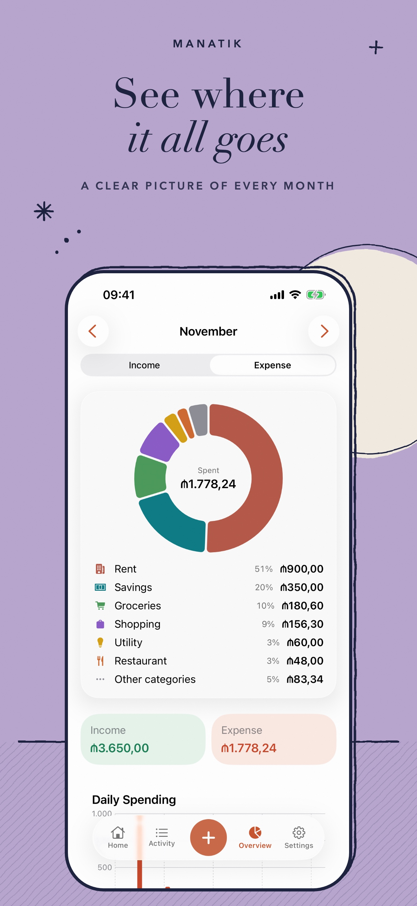
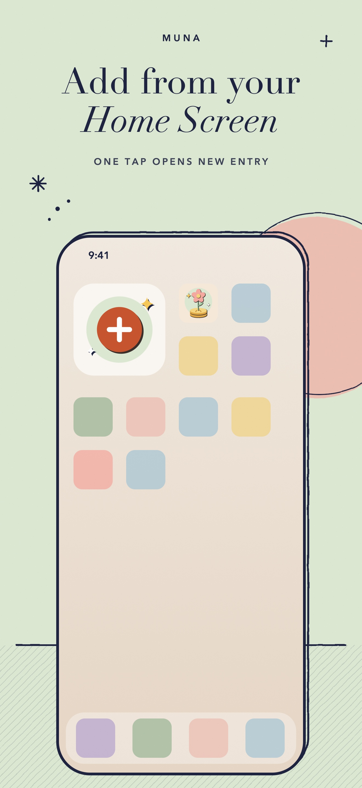

<p align="center">
  
</p>

<h1 align="center">muna</h1>
<p align="center"><em>money feels like home.</em></p>

**Muna — A Softer Way to Save.** Inspired by *Money + Serenity*, muna is a
cozy personal budget app for iPhone. It tracks spending, income, savings
goals, loans and bills, and keeps all of it on your phone.

<p align="center">
  
  
  
  
</p>

## Features

- **Home page styles:** Classic, or an illustrated room (cozy or poster;
  girl, boy or Christmas) where every object is a live button: the books
  open Expenses, Income, Bills and Loans, the jar shows savings, the clock
  opens reminders.
- **Fast entry:** the amount field opens with the number pad, thousands are
  grouped as you type, and categories can be searched.
- **Every currency:** each entry keeps its own currency (159 available);
  totals add up the main currency, with other currencies shown separately.
  Amounts are never converted.
- **Bills:** attach photos or PDFs to any entry and open them with Quick
  Look, including straight from Activity.
- **Savings goals, loans and payment reminders** with local notifications.
- **Overview:** spending by category, income vs expense, daily spending and
  a year view.
- **Hide amounts** with one tap (shown as `---- ₼`).
- **Import and export:** JSON backup and restore, and CSV import from other
  budget apps.
- **Quick add widget** for the Home Screen and Lock Screen.
- **Feedback:** shake the phone to email a report with a screenshot.
- **Languages:** English, Azerbaijani and Russian.
- **Private by design:** no account, no server, no analytics. See
  [PRIVACY.md](PRIVACY.md).

## Requirements

- iPhone with **iOS 17.6** or later. Liquid Glass is used on iOS 26 and
  later; iOS 17 and 18 get the standard material.
- **Xcode 26** or later to build.

## Building

1. Open `muna.xcodeproj` in Xcode.
2. Select the **muna** scheme and an iPhone or simulator.
3. In **Signing & Capabilities**, choose your team for both targets,
   **muna** and **MunaWidget**.
4. Press **Run**.

No packages or setup steps are needed; the project has no third-party
dependencies.

> **Building from a sandboxed shell:** if every `@State` / `@Observable` /
> `#Preview` fails with "external macro implementation type could not be
> found", pass `OTHER_SWIFT_FLAGS='$(inherited) -disable-sandbox'` to
> `xcodebuild`. Builds from Xcode itself are not affected.

## Project layout

| Folder | Contents |
|---|---|
| `App/` | App entry point, splash, deep links (`muna://add`), DEBUG launch options |
| `Core/` | Theme, colours, Liquid Glass wrappers with older-iOS fallbacks |
| `Models/` | Entries, series, goals, loans, reminders, settings |
| `Store/` | `AppStore`, the single observable source of truth |
| `Persistence/` | Versioned JSON storage with migrations and safety copies |
| `Services/` | Attachments, reminders, CSV import, feedback email |
| `ViewModels/`, `Views/`, `Components/` | SwiftUI screens and shared pieces |
| `Utilities/` | Formatting, amount input, date ranges, analytics |
| `Resources/` | Asset catalog, string catalog (en/az/ru), privacy manifest |
| `Widget/` | The Quick add widget extension |
| `Design/` | Source artwork, App Store posters, deck and the scripts that build them |

## Data

Budget data is stored as a single JSON file in the app's Documents folder
(`manatik-state.json`, a name kept from before the rename so existing data
still opens), with attachments under `Documents/Attachments`. Both are
protected while the device is locked. The file format is versioned, and
older formats are migrated on load. If the file cannot be read, the app
refuses to save over it.

## Screenshots and store assets

DEBUG builds accept launch options for repeatable screenshots, for example:

```
xcrun simctl launch <device> com.minayayagubova.manatik -qa-seed -qa-home posterGirl
xcrun simctl launch <device> com.minayayagubova.manatik -qa-seed -qa-route add -qa-amount 24,50
```

`-qa-seed` swaps in demo data held in memory, so the real data file is never
touched. Other options: `-qa-tab`, `-qa-route`, `-qa-hide-amounts`,
`-qa-no-glass` (shows the iOS 17/18 look) and `-qa-open-url`.

To rebuild the App Store posters from a folder of screenshots:

```
python3 Design/make_store_posters.py <screenshots folder> Design/AppStore
```

Store text (subtitle, keywords, What's New) is in
`Design/AppStore/STORE_TEXT.md`.

## Feedback and support

Shake your iPhone in the app, or write to
[minaya.yagubova@icloud.com](mailto:minaya.yagubova@icloud.com).

## License

© 2026 Minaya Yagubova. All rights reserved.

## Voice entry MVP

On New Entry, tap the small microphone next to Income/Expense. Choose a
speech language if needed, then tap the round microphone to record. Tap Stop, correct the transcript if necessary, and
choose Review entry. The existing editable form shows the result; only Save
writes it to the ledger. Bills use the existing bookmark flag.

Settings → Language & voice offers an app language (Follow iPhone, English,
Russian or Azerbaijani) and a default dictation language. App language changes
apply immediately, including model-generated text. A temporary language change
in the recording sheet does not overwrite the saved default.

The searchable language picker lists all locales reported by Apple Speech,
with native language names and a separate section for languages unavailable
offline on the current device. Automatic matches iPhone language preferences
to an offline locale. Speech uses Apple's on-device recognizer exclusively,
with no API key or backend. Availability depends on the selected language and device; a language
in the picker is not a guarantee of offline support. Permission denial or
unavailable recognition leaves typed command entry available. Recording stops
after 45 seconds, on interruption, on backgrounding, or when leaving the sheet.

The rules accept one positive amount with up to two decimal places, numeric
or supported spelled-out numbers (preferring the selected speech locale),
income/expense keywords, visible category
names (including custom categories), and common Russian/English/Azerbaijani
aliases. Currency codes are supported, with common manat/dollar/euro names
and symbols. Unspecified currency uses the form's current currency. Missing
or ambiguous category uses Other. Review all fields before saving.

Dates default to today; spoken dates, recurring commands, loan creation,
savings actions, automatic language detection and multiple entries per command
are outside this MVP. Change the date and other fields in the review form.

Run parser regression checks on macOS with Xcode installed:

```sh
python3 Scripts/test_voice_parser.py
```

Before release, test real microphone recognition on supported iPhones,
permission allow/deny, unavailable languages, cancellation, interruptions,
and review/save/cancel with a test ledger.
